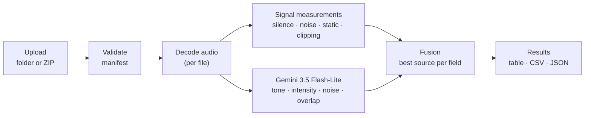

# AutoAce Voice Analyzer

Labels production call audio with the AutoAce schema: **emotional tone and intensity**, **background noise**
(present / type / severity), **audio quality**, **speaker overlap**, **long silence**, and a **confidence** score.
It is a hosted web dashboard (log in → upload a folder or ZIP → validate → process → review → download CSV/JSON)
plus a command-line tool that runs the same pipeline offline.

- **Hosted dashboard:** https://autoace-voice-analyzer.onrender.com (login provided separately)
- **Technical memo** (approaches, validation, cost, latency, privacy, failure modes): [`docs/MEMO.md`](docs/MEMO.md)
- **Result tables:** [`docs/results/`](docs/results/) · **Predictions for the provided calls:** [`predictions/`](predictions/)

**At a glance:** hybrid of deterministic signal processing and Gemini 3.5 Flash-Lite · measured
**$0.0018–0.0019 per audio-minute** (ceiling $0.003; ~40% headroom kept deliberately, since larger models and more
samples showed no accuracy gain) · ≈ 16 audio-minutes processed per wall-clock minute on the
hosted 0.5-CPU instance · 32 automated tests.

---

## Contents

1. [How it works](#1-how-it-works)
2. [Use the hosted dashboard](#2-use-the-hosted-dashboard)
3. [Batch format](#3-batch-format)
4. [Run it locally](#4-run-it-locally)
5. [Command-line usage](#5-command-line-usage)
6. [Reproduce the results](#6-reproduce-the-results)
7. [Deploy](#7-deploy)
8. [Configuration reference](#8-configuration-reference)
9. [Operations and troubleshooting](#9-operations-and-troubleshooting)
10. [Data handling](#10-data-handling)
11. [Repository layout](#11-repository-layout)

---

## 1. How it works



| Stage | What happens |
|---|---|
| **1. Upload and validate** | Reads the folder or ZIP, matches audio files to the CSV manifest, and reports any problems before processing |
| **2. Decode** | ffmpeg converts each file to 16 kHz audio; files run in parallel, each isolated, with retries and a memory budget |
| **3a. Signal measurements** | Deterministic checks (numpy/scipy): speech vs pauses, long silence, background level (SNR), mains hum, line-static clicks, clipping, loudness |
| **3b. Gemini** | Hears the call as lossless audio, with the spec's definitions and the measurements in the prompt; returns allowed values only; 1–3 independent samples per call depending on length |
| **4. Fusion** | Each field comes from the component that measured best on it (table below); the output is validated against the schema and given a confidence score |
| **5. Results** | Shown in the dashboard and downloadable as CSV or JSON |

**Which component decides each field**

| Field | Decided by |
|---|---|
| `emotional_tone`, `emotional_intensity` | Gemini (majority vote across samples) |
| `background_noise_*` | Gemini (voices, TV, music, …) **or** DSP steady-noise (SNR/hum) **or** DSP click-rate static |
| `audio_quality` | Gemini, raised by DSP clipping / very-low-level detectors |
| `speaker_overlap_present` | DSP when speakers are on separate channels, otherwise Gemini |
| `long_silence_present` | DSP (interior gap ≥ 10 s) |
| `confidence` | agreement between samples, agreement between DSP and Gemini on noise, silence-threshold margin |

Why each choice was made, and the evidence behind it, is in [`docs/MEMO.md`](docs/MEMO.md).

---

## 2. Use the hosted dashboard

1. Open https://autoace-voice-analyzer.onrender.com and sign in.
2. **Upload:** drag a folder or ZIP onto the drop zone, or use **Choose folder** / **Choose ZIP / files**.
   Optionally type a batch label. Click **Upload & validate**.
3. **Validation report:** shows the manifest used, how many files will be processed and how many have labels, and
   lists any problems: CSV rows without audio, audio not in the CSV (still processed), unsupported files (skipped),
   malformed `result_json` (treated as unlabeled), duplicate rows.
4. **Run:** pick a backend and click **Run analysis**.
   - **Hybrid (recommended):** the final system.
   - **Gemini only:** the ablation without DSP fusion.
   - **DSP rules only:** no API calls, $0; tone is not modeled.
5. **Results:** a live progress bar, a per-file table with all 9 fields, and a reason for any file that failed.
   Expand **Details** on a row for timings, cost, the model's short evidence notes and the DSP measurements.
   If the CSV contained labels, an accuracy panel shows per-field accuracy, tone macro-F1 and a tone confusion
   matrix, and mismatched cells are highlighted in red (hover to see the label).
6. **Download:** **Download CSV** or **Download JSON**. Rows keep the original audio filenames.
7. **History:** **Batches** lists earlier runs; **Open** reloads one, **Delete** removes it with its results.

Processing continues on the server if you close the tab; reopen it from **Batches**.

---

## 3. Batch format

```
evaluation_batch/            folder or ZIP; a single wrapper folder is fine
  call_001.wav
  call_002.mp3
  call_003.ogg
  labels.csv                 the manifest (any .csv name works; labels.csv is preferred if there are several)
```

**Manifest columns**

| Column | Required | Meaning |
|---|---|---|
| `name` | yes | exact audio filename including extension (case-insensitive match is accepted with a warning) |
| `result_json` | no | expected output as JSON. May be empty or the column omitted for unlabeled sets. A partial object is scored only on the fields it contains |

**Supported audio:** wav, mp3, ogg, opus, m4a, mp4, aac, flac, webm, wma, amr. Mono or stereo, any sample rate.

**Rules**
- Audio must sit at the batch root; files in nested subfolders are ignored and reported.
- No CSV? Every supported audio file is processed and a warning is shown.
- A corrupt, empty or unsupported file fails on its own with a reason; the rest of the batch continues.
- Files longer than 15 minutes are rejected with a clear message on the hosted 512 MB instance
  (`MAX_AUDIO_MINUTES`, §8).

**Output schema (per file)**

```json
{
  "emotional_tone": "neutral | satisfied | frustrated | upset | distressed",
  "emotional_intensity": "low | medium | high",
  "background_noise_present": true,
  "background_noise_type": "free text; empty string when no noise",
  "background_noise_severity": "none | low | medium | high",
  "audio_quality": "clear | slightly_impaired | severely_impaired",
  "speaker_overlap_present": false,
  "long_silence_present": false,
  "confidence": 0.72
}
```

Downloaded CSV columns: `name, result_json, status, error`, then one column per field.

---

## 4. Run it locally

### 4.1 Prerequisites

| Requirement | How to get it |
|---|---|
| Python 3.11–3.13 | https://www.python.org/downloads/ (or `pyenv`) |
| ffmpeg (includes ffprobe) | macOS `brew install ffmpeg` · Ubuntu/Debian `sudo apt install ffmpeg` · Windows `winget install Gyan.FFmpeg` |
| Gemini API key (for Hybrid / Gemini backends) | https://aistudio.google.com/apikey → **Create API key**; enable billing on that Google Cloud project (paid tier, so data is not used for training) |

The DSP-only backend and the test suite need no API key.

### 4.2 Install

```bash
git clone https://github.com/engineerdragon01/voice_analyzer.git
cd voice_analyzer
python3 -m venv .venv
source .venv/bin/activate          # Windows: .venv\Scripts\activate
pip install -r requirements-dev.txt
pytest -q                          # expect: 32 passed
```

### 4.3 Configure

```bash
cp .env.example .env
```

Edit `.env` and set at least:

```
GEMINI_API_KEY=your-key
DASH_PASS=choose-a-password        # login is disabled until this is set
```

### 4.4 Start the dashboard

```bash
set -a; source .env; set +a        # load .env into the shell
uvicorn app.main:app --port 8000
```

Open http://localhost:8000 and sign in as `autoace` (or your `DASH_USER`) with `DASH_PASS`.
Data (SQLite database and temporary uploads) goes to `./data/app`.

### 4.5 Run with Docker instead (optional)

```bash
docker build -t autoace-voice-analyzer .
docker run --rm -p 8000:8000 \
  -e GEMINI_API_KEY=your-key -e DASH_PASS=choose-a-password \
  -e COOKIE_SECURE=0 \
  -v "$PWD/data/docker:/data" \
  autoace-voice-analyzer
```

`COOKIE_SECURE=0` is needed only on plain `http://localhost`: the image defaults to secure (HTTPS-only) cookies
for hosting, and the browser would otherwise drop the login cookie.

---

## 5. Command-line usage

The CLI runs exactly the same pipeline as the dashboard (`analyzer/pipeline.py`).

```bash
python cli.py path/to/batch -o results/run1                  # hybrid backend (default)
python cli.py path/to/batch -o results/run1 --backend dsp    # no API calls
```

| Option | Default | Meaning |
|---|---|---|
| `--backend` | `hybrid` | `hybrid`, `gemini` (no DSP fusion) or `dsp` (no API) |
| `--model` | `gemini-3.5-flash-lite` | any Gemini model name |
| `--samples` | `3` | maximum samples per clip (the budget guard may use fewer) |
| `--prompt` | `v2` | prompt version in `analyzer/prompts/` |
| `--workers` | `4` | files processed in parallel |

**Outputs** (next to the `-o` prefix):

| File | Contents |
|---|---|
| `run1.csv` | `name, result_json, error`: the submission format |
| `run1.json` | the same rows as JSON |
| `run1.meta.json` | per file: timings, token usage, cost, DSP measurements, model samples |
| `run1.metrics.json` | accuracy, macro-F1, confusion matrix (only when the manifest has labels) |

The CLI also prints the validation report, audio minutes, total cost and cost per audio-minute, and a metrics table
when labels exist.

---

## 6. Reproduce the results

The provided audio is confidential and is **not** in the repository. Put the three calls and `labels.csv` in
`data/provided/` (the `data/` folder is git-ignored).

| What | Command | Output |
|---|---|---|
| Comparison matrix (6 configurations, each Gemini run ×2) | `python -m eval.experiments data/provided docs/results/experiments.md` | `docs/results/experiments.md` |
| Final predictions | `python cli.py data/provided -o predictions/provided_calls` | `predictions/provided_calls.*` |
| Build the synthetic set (34 clips with known silence, noise and impairments) | `python -m eval.synthetic build data/provided data/synthetic` | `data/synthetic/` |
| Score a run on the synthetic set | `python cli.py data/synthetic -o results/syn` then `python -m eval.synthetic score data/synthetic/labels.csv results/syn.csv` | per-field accuracy, misses |
| Cost and latency summary of any run | `python -m eval.benchmark results/run1.meta.json` | JSON summary |
| Cost projection by clip length | `python -m eval.benchmark --projection gemini-3.5-flash-lite` | table |
| Re-score a fusion change without API calls | `python -m eval.refuse results/run1.meta.json data/provided/labels.csv data/provided` | metrics |
| Tests | `pytest -q` | 32 passed |

Gemini sampling is seeded per sample, but the hosted model is not bit-for-bit deterministic, so confidence values can
move by a few hundredths between runs; labels were stable across repeated runs (see the experiment table).

---

## 7. Deploy

### 7.1 Render (what the hosted dashboard uses)

1. Push the repository to GitHub.
2. In Render: **New + → Blueprint** → connect the repository → branch `main`. Render reads
   [`render.yaml`](render.yaml), which defines a Docker web service on the **Starter** plan with a **1 GB disk at
   `/data`** and a `/healthz` health check.
3. When prompted, set the secret environment variables:
   - `GEMINI_API_KEY`: your paid-tier key
   - `DASH_PASS`: the dashboard password (`DASH_USER` defaults to `autoace`; `SESSION_SECRET` is generated)
4. Click **Apply** and wait for the first build (a few minutes). Then open the service URL, sign in, and run a
   small batch.
5. Every push to `main` redeploys automatically. Results persist on the disk across deploys.

Use **Starter or larger**: the free plan sleeps after 15 idle minutes (about a one-minute wake-up) and cannot attach
a disk. On a plan with more memory, raise `AUDIO_MINUTES_BUDGET` and `MAX_AUDIO_MINUTES` (§8).

### 7.2 Railway

New project → **Deploy from GitHub repo** (uses [`railway.json`](railway.json) and the Dockerfile) → add a volume
mounted at `/data` → set the same variables as above.

### 7.3 Any Docker host

Use the `docker run` command from §4.5 without `COOKIE_SECURE=0`, behind HTTPS. The container listens on `$PORT`
(default 8000) and stores everything under `/data`.

### 7.4 Keeping audio in your own cloud (Vertex AI)

Set `GOOGLE_GENAI_USE_VERTEXAI=true`, `GOOGLE_CLOUD_PROJECT` and `GOOGLE_CLOUD_LOCATION`, and give the service
Google Cloud credentials. The same code path then calls Gemini through Vertex AI in your project and region.

---

## 8. Configuration reference

| Variable | Default | Purpose |
|---|---|---|
| `GEMINI_API_KEY` | – | Gemini Developer API key (required for Hybrid / Gemini) |
| `GEMINI_MODEL` | `gemini-3.5-flash-lite` | model; prices live in `analyzer/config.py` (unknown models are priced pessimistically) |
| `GEMINI_SAMPLES` | `3` | maximum self-consistency samples per clip |
| `TARGET_COST_PER_MIN` | `0.0025` | budget guard: samples per clip are reduced so projected cost stays below this |
| `PROMPT_VERSION` | `v2` | prompt file in `analyzer/prompts/` |
| `ANALYZER_BACKEND` | `hybrid` | default backend for the CLI |
| `LONG_SILENCE_S` | `10` | interior dead-air threshold in seconds |
| `DASH_USER` / `DASH_PASS` | `autoace` / – | dashboard login (disabled until `DASH_PASS` is set) |
| `SESSION_SECRET` | random per start | cookie signing key; set it so logins survive restarts |
| `COOKIE_SECURE` | `1` in Docker image | HTTPS-only cookies; set `0` for plain-HTTP local use |
| `DATA_DIR` | `./data/app` (`/data` in Docker) | SQLite database and temporary uploads |
| `WORKERS` | `4` | files processed in parallel |
| `AUDIO_MINUTES_BUDGET` | `15` | audio-minutes analyzed at once; long files queue instead of exhausting memory |
| `MAX_AUDIO_MINUTES` | `15` | longer files are rejected with a message (sized for 512 MB) |
| `MAX_UPLOAD_MB` | `1024` | maximum upload size |
| `KEEP_AUDIO` | `0` | uploaded audio is deleted after analysis unless set to `1` |
| `GOOGLE_GENAI_USE_VERTEXAI`, `GOOGLE_CLOUD_PROJECT`, `GOOGLE_CLOUD_LOCATION` | – | use Vertex AI instead of the Developer API |

---

## 9. Operations and troubleshooting

| Symptom | Cause and fix |
|---|---|
| Login page says "Invalid username or password" for every attempt | `DASH_PASS` is not set on the server (login stays disabled), or the wrong user/password |
| Logged in, but every request bounces back to login (local Docker) | secure cookies over plain HTTP: run with `COOKIE_SECURE=0` |
| "Gemini API key is not configured on the server" when starting a run | set `GEMINI_API_KEY`, or choose the DSP-only backend |
| A file fails with `404 … model … no longer available` | the model was retired for new users: set `GEMINI_MODEL` to a current Flash-Lite model and add its price to `analyzer/config.py` |
| A file fails with "audio too long" | over `MAX_AUDIO_MINUTES`; raise it on a larger instance |
| A file fails with "unreadable or corrupt audio" / "file is empty" | the file itself is damaged; the rest of the batch is unaffected |
| `ffmpeg` / `ffprobe` not found (local) | install ffmpeg (§4.1) and make sure it is on `PATH` |
| Batch stuck at "queued" after a restart | interrupted files are re-queued automatically on startup; a file interrupted twice is marked failed |
| First page load takes ~1 minute | the service is on a sleeping (free) plan; use Starter or larger |

**Logs:** Render → service → **Logs**. **Health:** `GET /healthz` returns `{"ok": true}`.
**Clearing history:** delete batches in the dashboard (§2). A running batch must be cancelled first.

---

## 10. Data handling

- Audio goes only to the Gemini API (paid tier: not used to train Google's models; Google may retain requests for
  a limited period for abuse monitoring). With Vertex AI it stays in your Google Cloud project.
- Uploaded audio is deleted right after each file is analyzed; only predictions, measurements and labels are kept
  in the SQLite database on the service's disk, and deleting a batch removes them.
- No audio, and no model text quoting callers, is committed to this repository (`.gitignore` covers audio files
  and `data/`).

---

## 11. Repository layout

```
analyzer/          the pipeline (shared by CLI and web app)
  audio_io.py        ffprobe/ffmpeg streaming decode, FLAC encoding for the API
  dsp.py             signal measurements (speech/pause, silence, SNR, hum, click rate, clipping, level)
  llm.py             Gemini client, cost accounting, retries
  prompts/           versioned prompts (v1, v2)
  fusion.py          combines model samples and DSP into the final fields; confidence
  config.py          settings, pricing table, per-clip budget guard
  schema.py          output schema and validation
  manifest.py        batch discovery and CSV validation
  metrics.py         accuracy, macro-F1, confusion matrix, Brier score
  pipeline.py        analyze_file(): one file end to end
app/               FastAPI server (login, upload, job queue, results, delete) and static dashboard
eval/              experiments matrix, synthetic set, benchmark, offline re-scoring
tests/             pytest suite (32 tests)
docs/MEMO.md       technical memo
docs/results/      experiment and synthetic result tables
predictions/       outputs for the three provided calls
cli.py             command-line entry point
Dockerfile, render.yaml, railway.json   deployment
```
